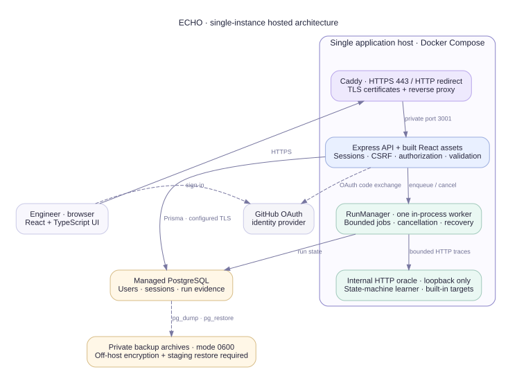

# Architecture and algorithm

## Hosted architecture diagram

The diagram shows the actual single-replica deployment, not a distributed or highly available service. Off-host encryption and restore drills must be configured by the operator.

## Request path

`React -> Express (auth, validation, tenant scope) -> RunManager -> HttpTraceOracle -> resettable target`.

`RunManager` persists status and reports through Prisma/PostgreSQL. It uses a single in-memory queue and one worker; the process marks unfinished jobs failed when it restarts. A new run takes a PostgreSQL row lock on its `User` record while checking per-account quotas. Account deletion uses the same lock, so a new queued run cannot slip in during deletion.

### Run lifecycle

`QUEUED -> RUNNING -> COMPLETED | FAILED | CANCELLED`, with `QUEUED -> CANCELLED` also allowed.

The worker claims a queued run using a conditional database update. Cancellation of a running run now persists `CANCELLED` first and then aborts the active HTTP request. Completion and failure updates require `status = RUNNING` so late results cannot overwrite cancellation. After a crash, unfinished work becomes `FAILED` with an explicit message. This is not a durable distributed queue or an exactly-once execution guarantee.

### Learning

The learner approximates a Mealy state machine (each action yields an output). It enumerates bounded action prefixes, compares future-output signatures over short distinguishing suffixes, and merges histories whose signatures match. A new signature becomes a state, until the access depth is exhausted. Longer traces test the candidate's predictions; a mismatch is reduced to its first incorrect prefix and saved as evidence.

The algorithm does not guarantee a minimal machine or complete equivalence. Query counts can rise exponentially with alphabet size and depth. Limits on access depth, suffix depth, verification depth, and query count are part of the API contract. Only successful traces are cached, per experiment. Every trace assumes an independent reset; non-resettable or nondeterministic services violate that assumption.

### Release Check

Reports store both machine transitions and selected observed traces. Two runs can therefore have identical learned machines yet differ in their evidence: the patched rate limiter changes output on request eight from `cooldown` to `denied`. Comparison never contacts the target again, so it is reproducible but can miss changes outside the saved samples.

### Data model

`User` owns many `Run` and `Session` records. Sessions store only a SHA-256 hash of the opaque cookie token; deleting an account cascades to both sessions and runs. Run list pages are ordered by creation time and ID; the optional cursor must belong to the same user. PostgreSQL migrations are checked in and applied on container startup.

### Deployment boundary

The local Docker Compose file binds the app to `127.0.0.1`. The hosted Compose file exposes only Caddy on ports 80/443, with the Node service and managed database on private networks. Only built-in targets are available in hosted mode; configured external targets are for operator-controlled local environments. One running API process owns the queue. Multiple API replicas require a durable, leased worker queue before they are supported.
